# Starship Flight Simulator

A browser-based simulator of SpaceX's Starship V3 and Super Heavy. You can fly a whole test flight, from the countdown at Starbase to the booster caught by the tower's chopsticks and the ship's belly-flop and splashdown on the other side of the world. You can let the autopilot fly it or take the controls yourself.

Everything runs in the browser: a 6-degree-of-freedom flight simulator in a Web Worker, and a Three.js renderer streaming real terrain and imagery of Starbase.

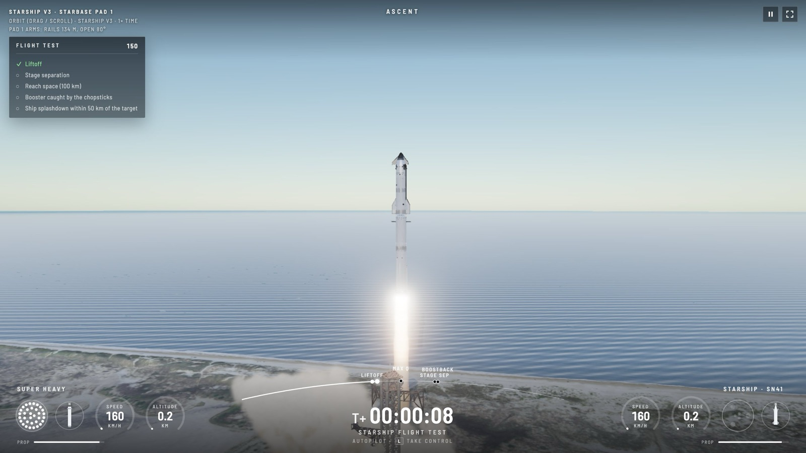

| | |
|---|---|
| 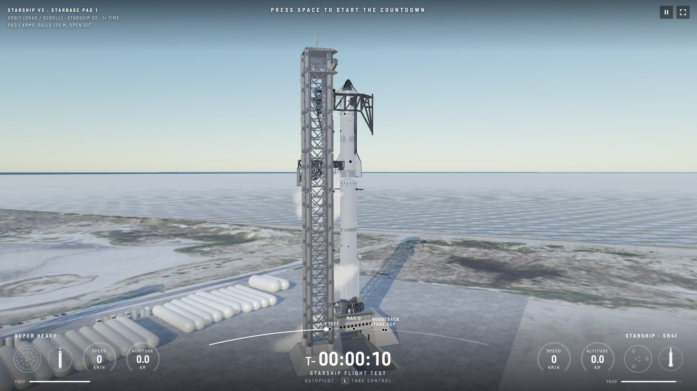 | 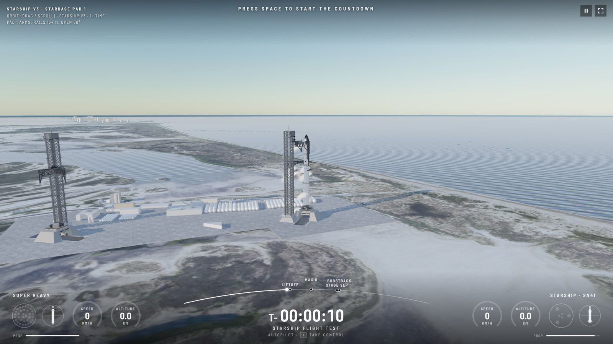 |
| 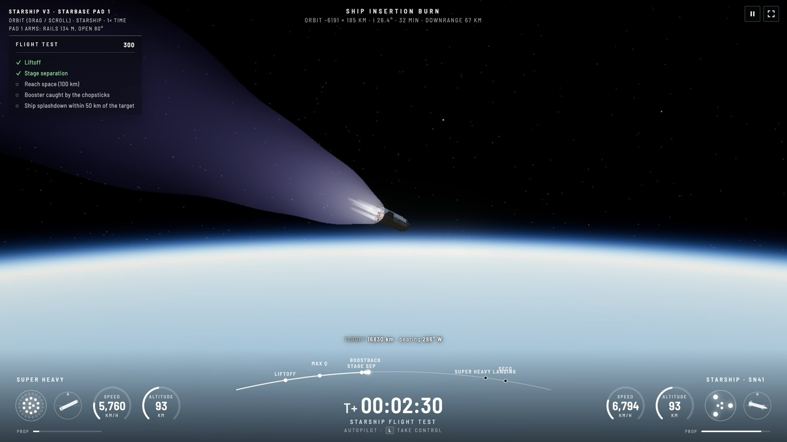 | 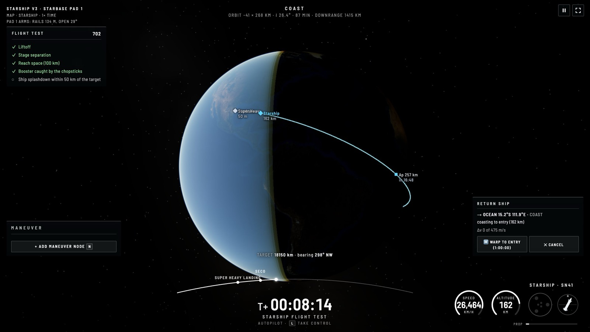 |
| 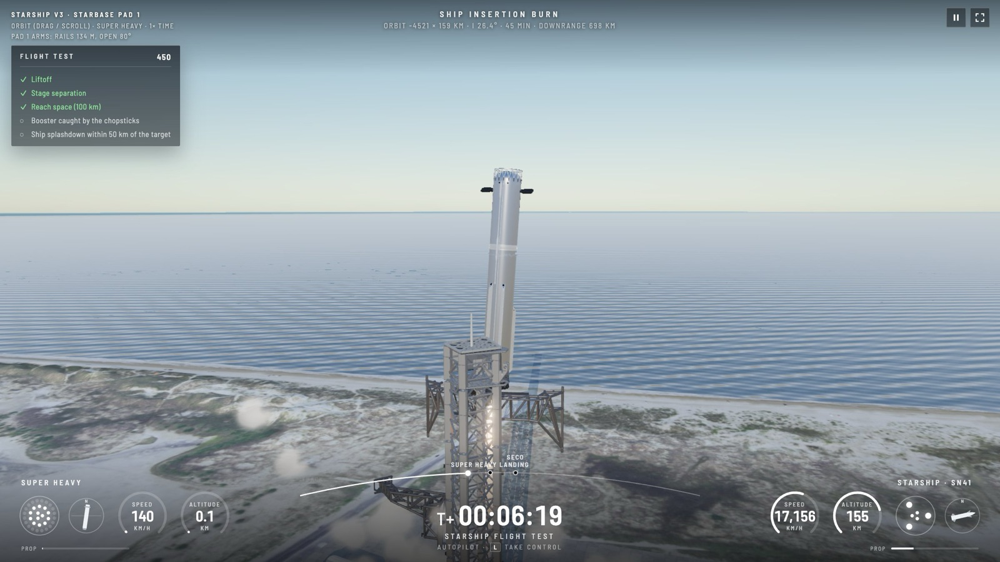 | 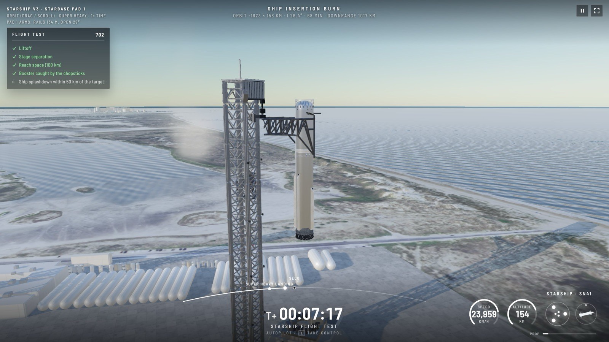 |
| 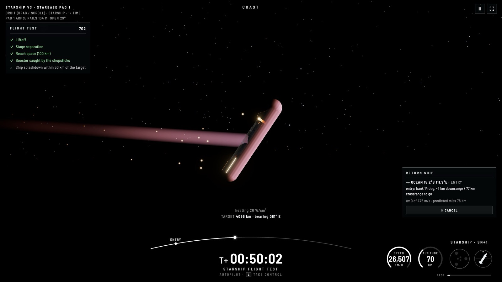 | 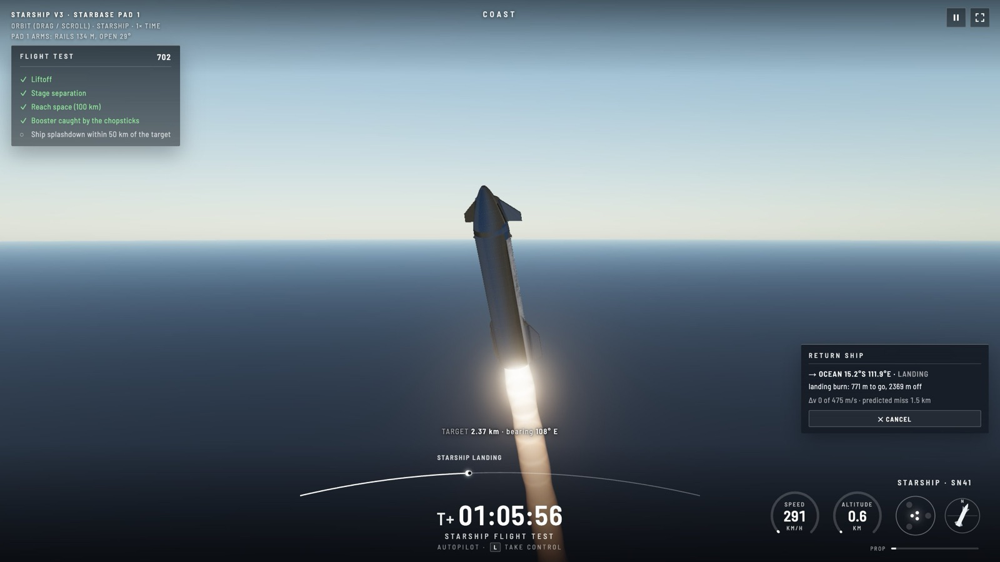 |
| 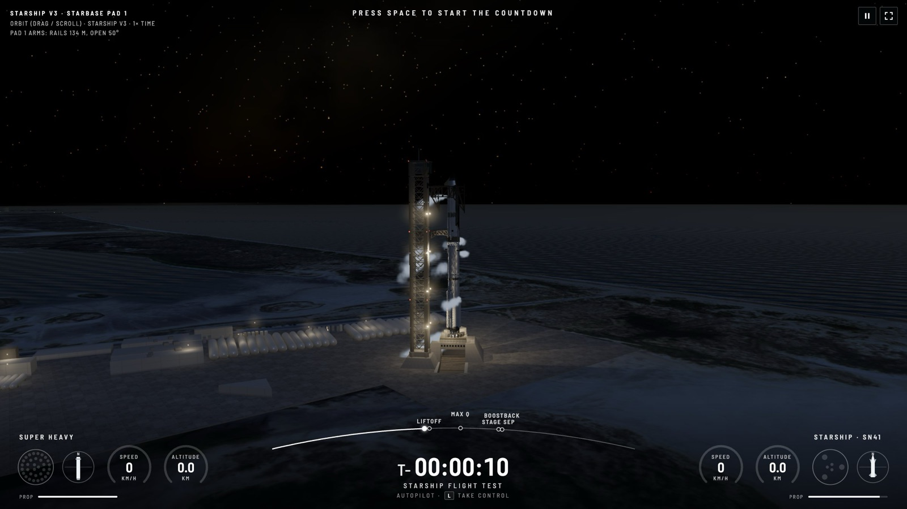 | 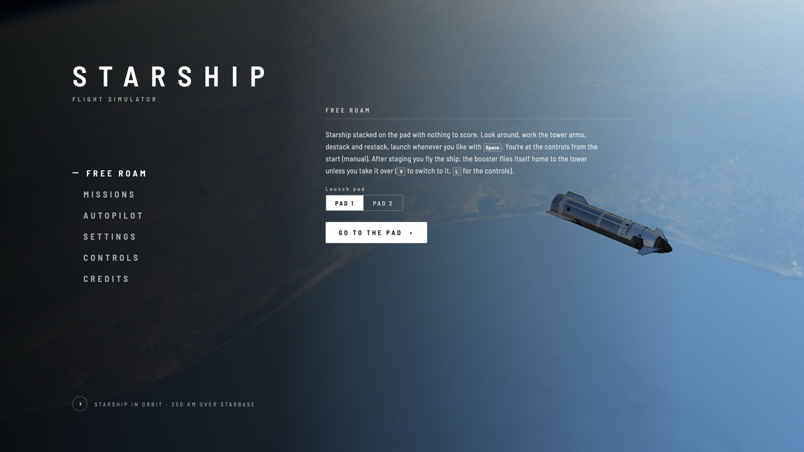 |

## What you can do

- **Free Roam:** the stack on the pad with nothing to score. Look around, work the tower arms, destack and restack, and launch whenever you like.
- **Autopilot:** the flight software flies the profile while you watch from any camera, the map or the webcast-style overlay. Press `L` at any moment to take over.
  - *Flight Test*: the full profile. Launch, hot staging, the booster back to the tower, and the ship through space and down in the Indian Ocean.
  - *Booster Return to the Tower*, *Booster Splashdown* (like the early flights) and *Ship Catch*.
- **Missions:** hand-flown challenges, each scored out of 1000:
  - *Hand-Flown Ascent*: fly through max-Q without breaking the stack up, stage, and cut the engines at the target apoapsis.
  - *Reach Orbit*: plan your own circularisation burn with a maneuver node.
  - *Booster Ocean Splashdown* and *Catch the Booster*: flip, boostback, fall engines-first, light the landing burn at the right moment and hover into the arms.
  - *Ship Reentry & Splashdown*: hold the heat shield into the plasma, belly-flop, then flip and land on the water.

The flight is shown the way the SpaceX webcasts show it: each vehicle's engine map, speed and altitude, and a mission timeline with its milestones.

## How it works

### The physics
The simulation (`src/sim/`) is plain TypeScript with no DOM or Three.js, so the same code runs in the game and in the tests.

- **Equations of motion:** each vehicle is a 6-degree-of-freedom rigid body integrated with RK4 at 100 Hz in an Earth-centred inertial frame, in double precision. Mass, centre of mass and inertia change as the tanks drain.
- **Gravity:** a point mass plus J2, the term that accounts for the Earth's flattening.
- **Atmosphere:** the US Standard Atmosphere 1976 (pressure, density, temperature and speed of sound up to orbit).
- **Engines:** every Raptor is modelled individually: 33 on Super Heavy (13 gimballing, 20 fixed) and 6 on Starship (3 sea-level, 3 vacuum). Thrust changes with ambient pressure, so sea-level engines gain about 5% on the way up and the big vacuum nozzles lose a lot at sea level. Each engine has a minimum throttle and a gimbal range and rate.
- **Aerodynamics:** slender-body theory plus viscous crossflow, so the forces stay sensible from nose-first flight all the way to broadside and tumbling.
- **Control surfaces:** the ship's four flaps and the booster's three grid fins are physical parts. Each has a hinge, an actuator with a limited speed, and makes its own force from its area, its angle to the airflow and whether the hull shelters it. The control system only chooses angles; the physics sees the forces those angles make.
- **Limits:** fly badly and things break. Side loads bend the long, thin tanks, and the stack peaks near 0.7 kPa of side load at max-Q in a nominal flight. Reentry heating uses the Sutton–Graves formula: the tiled belly can take it, but bare stainless steel turned into the flow heats up toward burn-through.
- **Tower:** the chopsticks are part of the simulation, with a carriage on the tower and two arms that swing at limited rates. Collisions with the arms and the tower are real.

Every vehicle number lives in [`src/sim/config/starshipV3.ts`](src/sim/config/starshipV3.ts), with the public sources it comes from. They are approximations: that file is the one place to tune against real flight data.

### The flight software
The autopilot flies the vehicles the same way a player would, by commanding attitude and throttle through the same control system.

- **Ascent:** a vertical rise, a small pitch-over toward the launch azimuth, then a zero-angle-of-attack gravity turn. The sequencer runs the countdown, ignition, max-Q, MECO, hot staging, separation, the ship's insertion burn and SECO.
- **Booster return:** after staging, Super Heavy flips and burns back toward the launch site. The boostback is aimed by an impact predictor that simulates the ballistic fall with drag and then the landing burn, and ends with a precise trim on the 3 centre engines. On the way down it vents propellant it won't need, adds an entry burn if the fall is too steep, and steers with the grid fins. The landing burn lights at the latest moment that still works with margin, worked out by fast-forward simulations of this particular booster (its mass, the air, its speed). It then hovers beside the arms on 3 engines and the chopsticks close.
- **Ship return:** from wherever the ship is, the autopilot plans a way home, either to an ocean target or to a tower catch. It searches the next day's orbits for a pass over the target, adds a circularisation or phasing burn when needed, picks the cheapest option and refuses if the propellant can't do it. Reentry is flown belly-first at about 60° angle of attack and steered by banking the lift. A predictor-corrector re-plans the landing point every second with bank reversals, like the Space Shuttle's entry guidance. Then come the belly-flop, the flip about 1 km up and the landing burn.

### Flying it yourself
The controls are fly-by-wire, in the style of Kerbal Space Program. Pitch, yaw and roll inputs command rotation rates, and the control system turns them into engine gimbal, flap, grid-fin and RCS commands. SAS can hold attitude or point prograde, retrograde, radial, normal, or (on the ship) at the entry attitude. There's a navball, a map view (`Tab`) with predicted trajectories, apoapsis and periapsis, entry interface and impact point, and maneuver nodes (`N`) for planning burns. Time warp goes up to "on rails" for coasts.

### The world
- **Terrain:** the ground streams in like a map app, as a quadtree of curved-Earth height tiles loaded around the camera.
  - *Around the pads (40 × 40 km):* 0.6 m USDA aerial imagery on 3 m USGS lidar elevation.
  - *200 × 200 km around Starbase:* the same aerial imagery (Sentinel-2 satellite imagery on the Mexican side and offshore) on 30 m Copernicus elevation.
  - *The rest of the world:* NASA's Blue Marble.
- **Starbase:** both pads are built at their real positions. The Mega Bays, Gigabay, tank farm and the rest of the site are extruded from OpenStreetMap, along with South Padre Island and Port Isabel across the water.
- **Sky:** a physically based atmosphere, with single Rayleigh and Mie scattering ray-marched per pixel. It gives blue skies, red sunsets, haze over distant land and the thin blue limb seen from orbit.
- **Weather:** planet-wide volumetric clouds that are new each flight, with rain under heavy cloud.
- **Night sky:** the real bright stars at their catalogue positions, the Milky Way, and the Moon at true scale in its real phase.
- **At night:** floodlights on the towers, lit buildings and red beacons.

### Effects and sound
- **Effects:** a light for every engine (so engine-outs and hot staging show) and plumes that go from a tight column with shock diamonds at sea level to a huge faint bell in near-vacuum. There's also the deluge and the liftoff cloud, propellant venting, and frost on the tanks that shows each tank's fill level and creeps down during the ascent. On reentry the heat-shield tiles glow, sparks stream off hot steel and plasma builds around the vehicle with the simulated heating.
- **Sound:** all of it is synthesised with Web Audio, including the engines, wind, surf, tower machinery, deluge, sonic booms and the clang of a catch. Rocket noise is modelled from each plume's acoustic power and arrives with the speed-of-sound delay: 9 km from the pad, liftoff is silent for about 26 seconds.

### 3D models
The vehicle and tower models start from community models (see [Credits](#credits)). Blender scripts in `art/blender/` scale them to full size, split the stack into booster and ship, add pivots for the engines, fins, flaps, arms and QD arm, and optimise them for real time. The finished models are already in `public/models/`, so you don't need Blender to run the game.

## Running it locally

You'll need [Node.js](https://nodejs.org/) 22 or newer.

```bash
npm install
npm run dev
```

Open the URL it prints. The other commands:

```bash
npm test        # physics and mission tests (full flights, landings, catches, orbits...)
npm run fly     # a headless flight that prints a telemetry table and the event log
npm run build   # production build into dist/
```

### Map data
The terrain and globe tiles (~10 GB, ~750k files) aren't in the repo. Without them the game still runs, but over a plain globe. To download and build all of it in one go:

```bash
pip3 install numpy scipy pillow   # needed by the build
npm run data                      # download + build everything; several hours, resumable
```

`npm run data` runs four steps you can also run on their own: `terrain:fetch`, `terrain:build`, `globe:fetch` and `globe:build`. No accounts or API keys are needed. If a download is interrupted, run it again and it picks up where it left off. Builds are written to `public/terrain.building` and swapped in when finished, so a running game never sees a half-built set.

### Rebuilding the 3D models
Only needed if you change the Blender scripts or the source models. It needs [Blender](https://www.blender.org/); the script expects it at `/Applications/Blender.app` (macOS), so change the path in `package.json` on other systems.

```bash
npm run models
```

## Controls

| Keys | |
|---|---|
| `Space` | Launch; stage in flight |
| `L` | Take control from the autopilot |
| `W` `S` / `A` `D` / `Q` `E` | Pitch / yaw / roll |
| `Shift` / `Ctrl` | Throttle up / down |
| `Z` / `X` | Full / cut throttle |
| `G` | Engine set |
| `T` | SAS on / off |
| `Tab` | Map view |
| `N` | Maneuver node |
| `C` / `V` | Camera / switch vehicle |
| `1`–`8`, `,` `.` | Time warp |
| `P` / `J` | Telemetry plot / event log |
| `↑` `↓` / `←` `→` / `[` `]` | Tower arms up and down / close and open / swing round the tower |
| `U` | Select pad |
| `M` / `H` / `F` | Sound / hide help / full screen |
| `Esc` | Pause menu |

Drag to orbit the camera and scroll to zoom.

## Project layout

- `src/sim/`: the physics and flight software (no DOM, no Three.js)
  - `config/starshipV3.ts`: every vehicle and mission number
  - `dynamics.ts`, `gravity.ts`, `atmosphere.ts`, `engine.ts`, `aero.ts`, `surfaces.ts`: the physics
  - `sequencer.ts`, `guidance.ts`, `control.ts`: the ascent and the control system
  - `boosterReturn.ts`, `landingPlan.ts`, `shipReturn.ts`, `shipReentry.ts`: getting both stages home
  - `pilot.ts`: the player's fly-by-wire and SAS
  - `limits.ts`, `tower.ts`, `padCollision.ts`, `trajectory.ts`
- `src/worker/`: runs the simulation off the main thread at 100 Hz and posts snapshots ~60 times a second
- `src/render/`: the Three.js scene with a floating origin, terrain and globe streaming, atmosphere, clouds, stars, the Moon, pad lights and effects
- `src/audio/`: the synthesised sound
- `src/ui/`: the menus, webcast overlay, navball, map labels, maneuver planner and telemetry plot
- `src/game/`: missions and scoring
- `tests/`: Vitest tests that fly whole missions headless
- `scripts/`: the terrain and globe pipelines, model optimisation and the headless flight
- `art/`: the source models and the Blender build scripts
- `deploy/`: how the public site is hosted (Caddy behind a Cloudflare tunnel; see [deploy/README.md](deploy/README.md))

## Credits
- Launch tower, chopsticks, QD arm and launch mount: "Starship Launch Tower & Launch Pad with Functional Chopsticks (1:144 scale)" by [MikeNotBrick](https://www.thingiverse.com/thing:5908857), [CC BY 4.0](https://creativecommons.org/licenses/by/4.0/). Scaled, re-assembled and re-materialed.
- Starship / Super Heavy: "SpaceX Starship Block 3" by [Clarence365](https://sketchfab.com/3d-models/spacex-starship-block-3-6f6c6f88a3eb4b4d822fdca66733fbb2), [CC BY 4.0](https://creativecommons.org/licenses/by/4.0/).
- Aerial imagery: USDA NAIP 2022 (public domain), via Microsoft Planetary Computer.
- Satellite imagery: contains modified Copernicus Sentinel data 2025–2026, via Microsoft Planetary Computer.
- Global imagery: NASA Blue Marble Next Generation (NASA Earth Observatory, public domain).
- Elevation: USGS 3D Elevation Program (public domain); Copernicus GLO-30 DEM © DLR e.V. 2010–2014 and © Airbus Defence and Space GmbH 2014–2018, provided under COPERNICUS by the European Union and ESA.
- Buildings and tanks: © [OpenStreetMap](https://www.openstreetmap.org/copyright) contributors (ODbL).

An independent fan-made simulator, not affiliated with or endorsed by SpaceX.

## License
The code is [MIT](LICENSE). The third-party models and data credited above keep their own licenses and aren't covered by it: the 3D models in `art/source/` and the models built from them in `public/models/` (CC BY 4.0, see `art/source/README.md`), and the map, imagery and elevation data.
